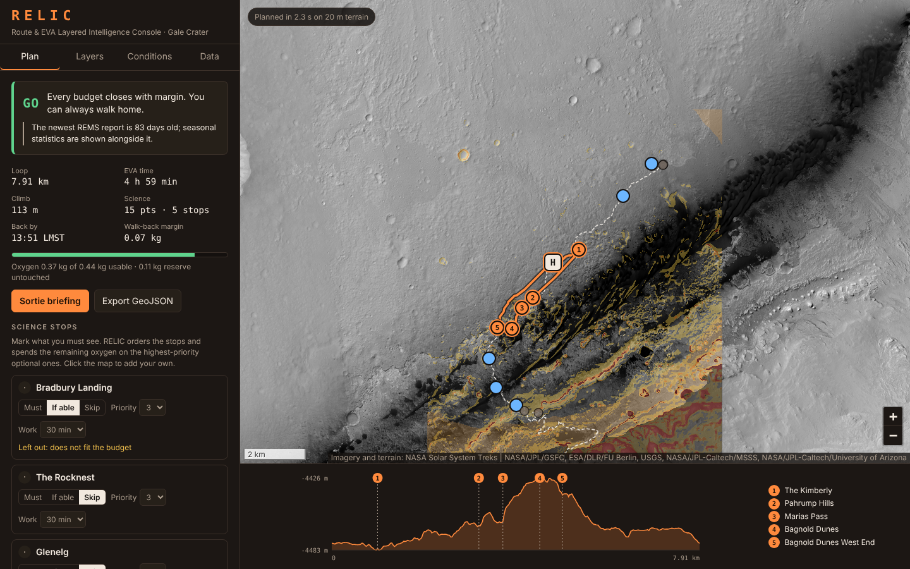

# RELIC: Route & EVA Layered Intelligence Console

**NASA Space Apps Challenge 2026 · Interplanetary Survival Guide: Martian Map · Team Relic**

RELIC plans a Marswalk at Gale Crater. An astronaut marks the science they must see; RELIC lays fourteen map
layers drawn from five NASA missions over one view, measures the ground on the real HiRISE elevation model, picks
and orders the stops that return the most science for the oxygen on their back, and proves that from every
point of the route they can still walk home.



Independent student project. Not affiliated with or endorsed by NASA.

## What makes it different

- **It runs on real terrain, live.** Slopes, climbs and walking costs come from the MRO HiRISE stereo
  elevation model of Gale Crater, fetched as raw float32 metres from NASA Solar System Treks. Zoom in,
  press one button, and RELIC re-plans on terrain down to a few metres per cell.
- **It optimises science, not just distance.** Choosing which stops to visit, and in what order, inside an
  oxygen and daylight budget is an orienteering problem. RELIC solves it exactly (subset dynamic programming
  over terrain-measured leg costs), so "must see" stops are honoured and the remaining oxygen buys the
  highest-priority optional science.
- **It proves the way home.** Along the whole route RELIC tracks the oxygen needed to abandon the plan and
  walk straight back, and draws the safe-return envelope on the map: the ground you cannot reach and return
  from is shaded out.
- **It is honest about conditions.** Mars local time, season, sunrise and sunset come from the NASA GISS
  Mars24 algorithm (unit-tested against NASA's worked example). Weather comes from Curiosity REMS; when the
  newest report is old, RELIC says so and shows what seven Mars years of REMS data recorded at this season.
- **It works with no link to Earth.** A bundled, reproducible snapshot of the NASA data keeps planning
  possible offline; live services replace it when they answer. No backend, no API keys.
- **It ends in a decision and a checklist.** GO, CAUTION or NO-GO, each with the number that triggered it,
  and a one-page printable sortie briefing in the spirit of the Apollo cuff checklists.

| The challenge asks for                            | RELIC                                                                                                                                                                                                    |
| ------------------------------------------------- | -------------------------------------------------------------------------------------------------------------------------------------------------------------------------------------------------------- |
| A layered, integrated view of a location or route | Viking, MOLA, MOLA+HRSC base maps; CTX and HiRISE imagery; THEMIS day and night infrared; TES dust; computed slope, relief and safe-return layers; Curiosity's traverse; NASA Exploration Zone regions   |
| Data from multiple NASA science missions          | Viking Orbiters, Mars Global Surveyor (MOLA, TES), 2001 Mars Odyssey (THEMIS), Mars Reconnaissance Orbiter (CTX, HiRISE), Mars Science Laboratory (REMS, RAD, drive log), NASA Human Landing Sites Study |
| Details of routes and destinations                | Least-energy paths on a 20 m (or finer) HiRISE grid, elevation profile, per-leg distance, time, climb and oxygen                                                                                         |
| Updates on current conditions                     | Mars24 clock and Sun, REMS weather with seasonal climatology, RAD radiation dose                                                                                                                         |
| Complete the mission quickly and safely           | Oxygen, time and daylight budgets, slope limits, walk-back margin, GO / CAUTION / NO-GO                                                                                                                  |
| New and exciting science along the way            | NASA's named Curiosity sites as candidate stops, user waypoints, priority-weighted science optimiser                                                                                                     |

## Run it

```bash
npm ci
npm run dev        # http://localhost:5173
npm run check      # typecheck + lint + 45 unit tests
npm run build      # static site in dist/
```

Node 20 or newer. The build is a static site: push to `main` and the included GitHub Actions workflow
tests it and publishes it to GitHub Pages (enable Pages, source "GitHub Actions", in the repository settings).

`npm run data:refresh` re-downloads the bundled snapshot from NASA and rewrites `public/data/manifest.json`.

## Two-minute demo

1. Open the app. It plans a five-stop loop from the habitat and shows **GO**.
2. **Layers**: toggle THEMIS night infrared (rock stays warm, sand goes cold) and the slope hazard layer.
3. **Plan**: set _Bradbury Landing_ to **Must**. The loop stretches to the landing site and the verdict
   drops to **CAUTION** with the oxygen margin that caused it.
4. Drag _Primary oxygen_ down to 0.25 kg. The safe-return envelope closes around the habitat and the verdict
   becomes **NO-GO**, with the shortfall in kilograms.
5. Reset, zoom in, **Data → Load finer terrain for this view**: live HiRISE terrain from NASA, re-planned.
6. **Sortie briefing → Print**.

## How it is built

- `src/core/`: pure TypeScript domain logic with no browser or framework imports (enforced by ESLint):
  Mars time, terrain, cost model, cost fields, planner, verdict, weather. All unit tests live here.
- `src/data/`: NASA endpoints, layer catalogue, snapshot and live loaders.
- `src/worker/`: the planner runs in a Web Worker so the map never freezes.
- `src/ui/`: React components and the Leaflet map.
- `scripts/fetch-data.ts`: regenerates the snapshot.

More in [docs/ARCHITECTURE.md](docs/ARCHITECTURE.md), [docs/MODEL.md](docs/MODEL.md) and
[docs/DATA_SOURCES.md](docs/DATA_SOURCES.md).

## Limits you should know about

- The suit and metabolic numbers are adjustable engineering assumptions, not NASA requirements
  ([docs/MODEL.md](docs/MODEL.md)).
- Terrain at 20 m does not show boulders or sand traps; slope is the only terrain hazard modelled.
  Use the HiRISE image layer to inspect the ground.
- Outside the HiRISE footprint only MOLA terrain (about 463 m) is available, which is too coarse for
  walking-scale slopes; the app labels it.
- Solar particle events are not forecast. Radiation shown is the average galactic-cosmic-ray dose from RAD.
- Curiosity REMS reports arrive irregularly; the app states the age of the newest one.

## Credits

Imagery, terrain and feature data: NASA Solar System Treks (JPL). Curiosity traverse and REMS feed: NASA Mars
Exploration Program; REMS data provided by Centro de Astrobiologia (CSIC-INTA). Instrument teams are credited
per layer in the app. Map library: Leaflet. Licence: MIT.
